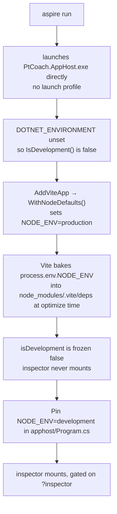
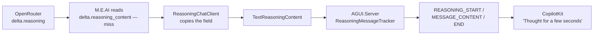

# Session notes — advanced chat features: reasoning, inspector, subagents

Written 2026-11-08. Covers a research-then-implement session on exposing advanced chat
features (subagent visibility, model reasoning, a dev-mode surface) in the PT Coach demo.

Read `CLAUDE.md`, `PLAN.md` and `CONTRACTS.md` first. This file is the "why" behind the
changes and the evidence for the claims in it; it is not a contract.

## The question

Nick asked whether the demo could show off the advanced chat affordances VS Code offers —
subagents you can see into, and the reasoning behind agent decisions — possibly behind a
dev-mode button. Then asked whether adding a subagent or two would speed the work up.

Short answers:

- **A dev surface already exists.** CopilotKit ships a Web Inspector with the react-core
  package we already depend on. It was switched off by one wrong environment variable.
- **Reasoning was on the wire and being thrown away** one layer below the agent.
- **Subagents: don't, yet.** The event contract is fully modelled on both ends, but nothing
  in this stack produces the events or renders them. Details below.

## What changed

| File | Change |
| --- | --- |
| `agent/Chat/ReasoningChatClient.cs` | **New.** Bridges OpenRouter's `reasoning` field to `TextReasoningContent` |
| `agent/Chat/ChatClients.cs` | Wires it innermost in `Instrument()` (line 91) |
| `agent.tests/ReasoningChatClientTests.cs` | **New.** 9 tests, builds real `Patch`-backed updates from wire JSON |
| `apphost/Program.cs` | `.WithEnvironment("NODE_ENV", "development")` on the web resource (line 27) |
| `web/src/App.tsx` | `messageFilter` drops reasoning from the request; `?inspector` opt-in (lines 114–132) |
| `README.md` | "Reasoning" and "CopilotKit Web Inspector" sections under Observability |
| `CONTRACTS.md` | Section 5: `NODE_ENV` row + two prose paragraphs. **Needs Nick's review.** |

Test count 103 → 112. No new tool names, no new test ids, no endpoint changes.

Package versions this was verified against: `@copilotkit/react-core` 1.85.0,
`@copilotkit/web-inspector` 1.85.0, `Microsoft.Agents.AI.Hosting.AGUI.AspNetCore`
1.28.0-preview.261106.1 (which brings `AGUI.Server` and `AGUI.Abstractions` 1.0.0),
`Microsoft.Extensions.AI.OpenAI` 10.11.0, Vite 8.3.6.

## Finding 1 — the inspector was off because of how Aspire starts

`@copilotkit/web-inspector` was already installed (it comes in with
`@copilotkit/react-core`) and `CopilotKitProvider` mounts it for us. The gate, from
`react-core/dist/copilotkit-*.mjs`:

```js
shouldEnableInspector({
  enableInspector,
  isBrowser: true,
  isDevelopment: process.env.NODE_ENV === "development"
}) && ["localhost", "127.0.0.1", "[::1]"].includes(window.location.hostname)
```

Two consequences worth remembering:

1. `enableInspector` can only **disable**. It cannot force the inspector on. A prop-based
   fix is impossible; the environment has to be right.
2. It is **localhost-only by design**, so it can never be the surface for a recorded or
   remote demo. It is a developer tool.

Why `isDevelopment` was false:



Complications found:

- **Deleting the Vite dep cache does not help.** It re-bakes the same value. The cache is a
  symptom, not the cause.
- **`apphost/Properties/launchSettings.json` does not help.** `aspire run` starts the exe
  directly and ignores it. Tried, then reverted.
- Setting `DOTNET_ENVIRONMENT=Development` would also fix it, but it changes more than the
  browser bundle. Pinning `NODE_ENV` on the one resource is the narrower change.

**How to tell the pin worked** without opening the browser: the console shows
`Lit is in dev mode. Not recommended for production!` and development-only CopilotKit
warnings. Both are silent under `NODE_ENV=production`.

## Finding 2 — reasoning was arriving and being discarded

All three configured models stream reasoning on OpenRouter, but the field name does not
match what `Microsoft.Extensions.AI.OpenAI` 10.11.0 looks for:

| Producer | Field |
| --- | --- |
| OpenRouter (deepseek, qwen, glm) | `choices[0].delta.reasoning` |
| `Microsoft.Extensions.AI.OpenAI` 10.11.0 | `choices[0].delta.reasoning_content` |

Everything above that layer was already correct: `AGUI.Server` 1.0.0 has
`ReasoningMessageTracker` and maps `TextReasoningContent` to `REASONING_*`, and CopilotKit
has `CopilotChatReasoningMessage` as a default slot. The gap was exactly one layer, so the
fix is a small `DelegatingChatClient` rather than custom UI.



### Quirk A — empty content split the reasoning into one block per token

First live run produced **6 `REASONING_START` for 6 chunks**. Cause: OpenRouter sends
`"content": ""` on every reasoning chunk. `ConvertContentParts` turns that into an empty
`TextContent`, and the AG-UI host closes the open reasoning block whenever it sees text
content. So each chunk became its own block.

Fix: drop empty `TextContent` parts when adding reasoning. After that, one run gave
**1 start / 15 content / 1 end**, and the UI showed exactly one block.

Note the distinction the code keeps: an empty text part is dropped, real text beside
reasoning is kept (`Real_content_beside_reasoning_is_kept`).

### Quirk B — replaying a thread with reasoning broke the next turn

Second turn failed with:

```
Couldn't reach the model — HTTP 500: System.InvalidOperationException: Unknown chat role: reasoning
```

`MapChatRole` lives in `AGUI.Abstractions.AGUIChatMessageExtensions` — **not** in
`AGUI.Server`, which is where you would look first. Its only overload takes a role string
and returns a `ChatRole`. Verified by invoking it directly:

| Input | Result |
| --- | --- |
| `system`, `user`, `assistant`, `developer`, `tool` | maps through |
| `reasoning` | throws `InvalidOperationException: Unknown chat role: reasoning` |
| `activity` | throws the same way |

`AGUIMessage.Role` is a plain `string`, so the message itself deserialises fine — it is the
conversion to `ChatRole` that fails. CopilotKit replays the whole thread every run, so the
reasoning message poisoned the following request.

Fix: `messageFilter` on the provider. It rewrites the **request body only** — the rendered
transcript keeps its thought blocks.

```ts
function dropReasoningFromRequest<T extends { role: string }>(messages: T[]): T[] {
  return messages.filter((m) => m.role !== "reasoning");
}
```

Gotcha: the filter must return `Message[]`. Typing it as `Message[]` directly fights the
generic, so it is generic and constrained instead.

## Finding 3 — the inspector launcher intercepts clicks

Playwright failed with:

```
<cpk-web-inspector> … intercepts pointer events
```

The launcher is a 62×62 fixed target top-right; with the panel open the host is ~960×740
over the page. It would break `e2e/demo.spec.ts` clicks.

So the inspector is opt-in via `?inspector`, not default-on. Verified both ways on the
Aspire port: `/` has no `cpk-web-inspector` element, `/?inspector` mounts it.

`e2e/demo.spec.ts` only collects `console` messages of type `error`
(`if (m.type() === "error")`), so the new development-only `[CopilotKit] … no renderer is
registered` warnings do not fail the suite. They are informative, not noise — they name the
unrendered tools (`getClient`, `searchExercises`).

## Subagents — what actually exists

This is the part to revisit with fresh eyes if the demo ever needs to show them. The
earlier assumption that nothing supports them was **too pessimistic**; the accurate picture
is more interesting and splits cleanly in two.

**The event contract is fully modelled on both ends.**

- `AGUI.Abstractions.dll` 1.0.0 has `SubagentStartedEvent`, `SubagentFinishedEvent`,
  `SubagentErrorEvent`, `SubagentFinishedOutcome` (plus `Success` and `Suspended`
  variants), `SubagentInfo`, and `SubagentRunId` / `ParentSubagentRunId` fields on
  messages. It serialises `SUBAGENT_STARTED` / `SUBAGENT_FINISHED` / `SUBAGENT_ERROR`
  correctly.
- `@ag-ui/core` and `@ag-ui/client` handle `SUBAGENT_*` properly, including
  `parentSubagentRunId` nesting.
- `@copilotkit/shared/dist/finalize-events.mjs` tracks open subagent runs and closes them
  on stop, so a `RUN_FINISHED` with an open subagent is handled rather than leaked.

**But nothing produces or renders them.**

- `AGUI.Server` 1.0.0 (`AGUIStreamOptions`) offers only `MapContent`, `MapCall`,
  `MapResult*`, `MapInterrupt`, `MapUsageProvider`, `MapStreamingToolCallArguments`. There
  is **no subagent mapping hook**, and no code path that emits `SUBAGENT_*` from a normal
  agent run. Zero `SubagentStartedEvent` references in that assembly.
- `@copilotkit/react-core` references subagent names **only as re-exported zod schemas**
  (`SubagentStartedEventSchema`, `SubagentRunIdSchema`, …). There is no `subagentRunId` in
  any rendering path, and `@copilotkit/web-inspector` has **zero** occurrences of
  `subagent` — the inspector will not show them.
- `@copilotkit/core` explicitly documents that `subagentRunId` is **ignored** in its
  message/tool-result pairing logic.

So today a subagent would have to be emitted by hand and rendered by hand. Microsoft Agent
Framework can express it (`AIAgent.AsAIFunction()`), but it surfaces as an ordinary tool
call — which the demo already handles via `ConnectedAgentStatusStrip`.

To build it properly: emit `SUBAGENT_*` yourself (the abstraction types are public, so this
is a custom event over the stream, not a fork), render the nesting in our own UI, and add the
tool name to `CONTRACTS.md` section 3. That last part is a contract decision, which is why it
was parked rather than guessed at.

**On "would a subagent or two speed this up":** no. The research was one causal chain
(`NODE_ENV → Aspire → Vite`), so parallel agents would have duplicated the same derivation
rather than shortening it. The remaining blocker was a product decision, and agents do not
make those.

## Verification

Run against a fresh `aspire run`, not carried over from the investigation.

| Check | Result |
| --- | --- |
| `dotnet build PtCoach.slnx` | 0 warnings, 0 errors |
| `dotnet run --project agent.tests` | 112/112 |
| `node --test "web/src/components/declarative/*.test.mjs"` | 24/24 |
| `node …/typescript/bin/tsc --noEmit` from `web/` | clean |
| `npx playwright test` | 9/9 (58.6s) |
| Reasoning, live DeepSeek | two "Thought for…" blocks with real text, no alert |
| Inspector | absent on `/`, present on `/?inspector` |

## Environment gotchas hit during this session

- **`dotnet build`/`test` fail with MSB3027/MSB3021 while Aspire runs.** The agent locks its
  own DLLs. Stop Aspire first.
- **`npx tsc` is broken in this repo** — it resolves to a stale path. Use
  `node ..\node_modules\typescript\bin\tsc --noEmit` from `web/`.
- **`mobile.spec.ts` is timing-sensitive** against the replay model. One transient failure
  under full-suite load passed in isolation and on re-run; treat a lone failure there as
  suspected flake before debugging.
- A detached `aspire run` leaves a `PtCoach.Agent` process behind after the CLI stops.
  Check with `Get-Process PtCoach.Agent` and stop it by pid.
- **`node_modules` is gitignored, so the `grep` tool skips it.** Verify third-party claims
  with `Select-String` / `[IO.File]::ReadAllBytes` instead, or you will conclude a feature is
  absent when you simply searched nothing.
- **Reading a .NET DLL needs the right encoding.** UTF-16 for string literals in the `#US`
  heap, UTF-8 for metadata type names. Reading the wrong way returns 0 matches and looks
  like proof of absence. Both were used above, per target.

## Open items

1. **Review the `CONTRACTS.md` diff.** `CLAUDE.md` says that file is law. The `NODE_ENV` row
   is a factual record of a config var Aspire already injects; the two prose paragraphs
   document behaviour, not new surface. Nothing was added to section 3 or 7.
2. **The inspector is not on-theme.** Stock Tailwind grays against "Chalk and steel". Fine as
   a debugging aid; if it ever needs to appear in a recorded demo it needs theming, and the
   launcher would need relocating.